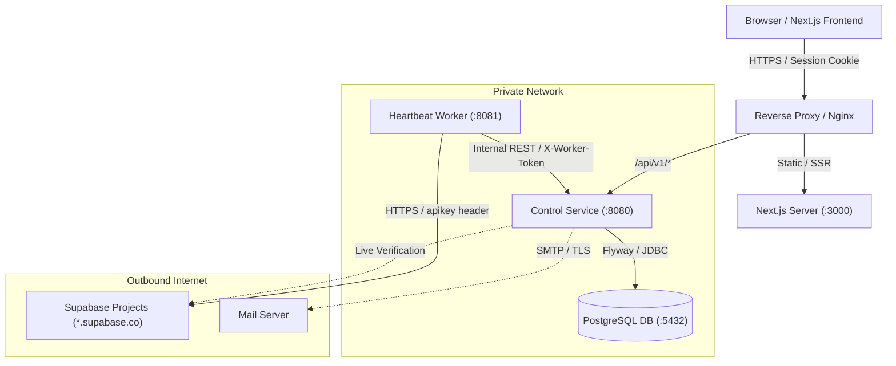
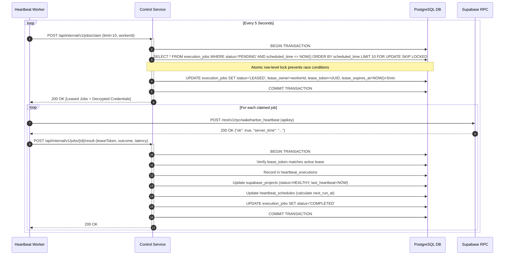

# WakeHarbor — System Architecture

**Document Version:** 1.0  
**Target Release:** Private, Single-Admin MVP  
**Classification:** Engineering Architecture Specification  

---

## 1. Architectural Philosophy

WakeHarbor is designed with a strict, pragmatic microservices boundary centered on security, isolation of concerns, and reliable asynchronous execution.

Instead of introducing complex message brokers (Kafka, RabbitMQ) or distributed service registries (Eureka, Consul) for a single-admin MVP, WakeHarbor achieves enterprise-grade durability through:
1. **Relational state persistence** in PostgreSQL using ACID guarantees.
2. **Atomic job leasing** via `SELECT ... FOR UPDATE SKIP LOCKED`.
3. **Internal machine-to-machine HTTP communication** secured by cryptographic service tokens.
4. **Autonomous worker decoupling**: The execution worker can be scaled, restarted, or moved across servers without disturbing the API or frontend.

---

## 2. High-Level Component Topology

---

## 3. Microservice Roles & Boundaries

### 3.1 Service A: Control Service (`services/control-service`)
- **Port:** `8080`
- **Database Access:** Exclusively owns and accesses the PostgreSQL application database.
- **Key Responsibilities:**
  - Administrative session management, BCrypt password hashing, and sliding-window rate limiting.
  - Project registration, Supabase URL canonicalization, and AES-256-GCM credential encryption.
  - Schedule generation, next-run calculation, and manual "Run Now" job dispatch.
  - Durable job leasing: atomically assigns pending execution jobs to workers.
  - Fault recovery: periodically reclaims expired leases from failed worker nodes.
  - Ingests verified execution results and transitions project operational states.
  - Emits deduplicated incident and recovery alerts.
  - Exposes public REST API for frontend and OpenAPI/Swagger documentation.
  - Exposes secured internal API (`/api/internal/v1/*`) for heartbeat workers.

### 3.2 Service B: Heartbeat Worker (`services/heartbeat-worker`)
- **Port:** `8081`
- **Database Access:** **Zero.** The worker has no JDBC dependencies or database credentials.
- **Key Responsibilities:**
  - Autonomous polling loop against the Control Service's `/api/internal/v1/jobs/claim` endpoint.
  - Decrypts job targets delivered over the secured internal network.
  - Validates outbound target URL against SSRF rules prior to socket connection.
  - Dispatches read-only POST request to `https://<ref>.supabase.co/rest/v1/rpc/wakeharbor_heartbeat`.
  - Enforces 15-second timeouts, disables automatic redirects, and validates response schema.
  - Classifies status codes into diagnostic taxonomies (`SUCCESS`, `AUTHENTICATION_FAILED`, `FUNCTION_NOT_FOUND`, `PROJECT_PAUSED`, `RATE_LIMITED`, `TIMEOUT`, `NETWORK_ERROR`).
  - Submits results idempotently to Control Service (`/api/internal/v1/jobs/{id}/result`).
  - Emits continuous heartbeat telemetry (`/api/internal/v1/workers/heartbeat`) for liveness detection.

---

## 4. Durable Job Leasing Protocol

To guarantee that duplicate executions are avoided and that jobs are never lost when a worker crashes, WakeHarbor implements a transactional leasing state machine:

### Crash Recovery Mechanism
If a worker crashes, loses power, or suffers a network partition after leasing a job:
1. `JobLeasingService` runs a scheduled recovery scan every 60 seconds.
2. Identifies any job where `status = 'LEASED'` and `lease_expires_at < NOW()`.
3. Checks `attempt_count`:
   - If `attempt_count < 3`: Resets job to `PENDING` with exponential backoff and clears lease token.
   - If `attempt_count >= 3`: Marks job as `FAILED`, records a diagnostic execution log, and triggers an incident alert.

---

## 5. Security & Isolation Boundaries

1. **Application Database vs. Monitored Projects:**
   - The WakeHarbor application database is completely separate from any Supabase database being monitored.
   - WakeHarbor never executes arbitrary SQL against Supabase; it only invokes the safe `wakeharbor_heartbeat()` RPC function.
2. **Credential Isolation:**
   - API keys are encrypted at rest using AES-256-GCM.
   - Credentials are never logged in application traces or returned to frontend browsers.
   - The worker only receives decrypted keys in memory when actively leasing a job.
3. **Internal API Protection:**
   - Worker endpoints (`/api/internal/v1/**`) require an immutable `X-Worker-Token` header.
   - Requests without this token or with invalid tokens are rejected with HTTP 403.
   - In production environments, internal endpoints should be restricted to private Docker network bridges.
