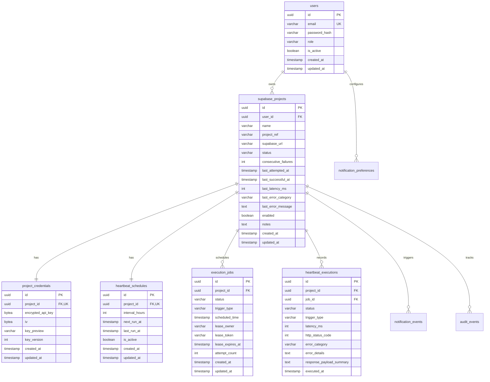

# WakeHarbor — Database Schema & Data Model

**Database Engine:** PostgreSQL 16+  
**Schema Migration Tool:** Flyway (`src/main/resources/db/migration/V1__initial_schema.sql`)  
**UUID Generation:** `gen_random_uuid()`  

---

## 1. Schema Overview & Entity-Relationship Diagram

---

## 2. Table Specifications

### 2.1 `users`
Stores administrative accounts. Prepared with `user_id` relations for future multi-tenant expansion.
- `id` (UUID, Primary Key)
- `email` (VARCHAR(255), UNIQUE, NOT NULL)
- `password_hash` (VARCHAR(255), NOT NULL) — BCrypt hash (cost 12)
- `role` (VARCHAR(50), NOT NULL) — `ADMIN`
- `is_active` (BOOLEAN, DEFAULT TRUE)
- `created_at`, `updated_at` (TIMESTAMPTZ, NOT NULL)

### 2.2 `supabase_projects`
Core project configuration and aggregated health indicators.
- `id` (UUID, Primary Key)
- `user_id` (UUID, Foreign Key -> `users.id`, ON DELETE CASCADE)
- `name` (VARCHAR(255), NOT NULL)
- `project_ref` (VARCHAR(100), NOT NULL) — Subdomain prefix (e.g. `xyzcompany`)
- `supabase_url` (VARCHAR(500), NOT NULL) — Canonical URL (e.g. `https://xyzcompany.supabase.co`)
- `status` (VARCHAR(50), NOT NULL) — `HEALTHY`, `DEGRADED`, `CONNECTION_FAILED`, `AUTHENTICATION_ERROR`, `PAUSED_BY_USER`, `SUPABASE_PAUSED`, `UNKNOWN`
- `consecutive_failures` (INT, DEFAULT 0)
- `last_attempted_at` (TIMESTAMPTZ)
- `last_successful_at` (TIMESTAMPTZ)
- `last_latency_ms` (INT)
- `last_error_category` (VARCHAR(100))
- `last_error_message` (TEXT)
- `enabled` (BOOLEAN, DEFAULT TRUE)
- `notes` (TEXT)
- **Indexes:** `idx_projects_user_id`, `idx_projects_status`, `idx_projects_ref`

### 2.3 `project_credentials`
Isolated storage for encrypted API keys.
- `id` (UUID, Primary Key)
- `project_id` (UUID, Foreign Key -> `supabase_projects.id`, UNIQUE, ON DELETE CASCADE)
- `encrypted_api_key` (BYTEA, NOT NULL) — AES-256-GCM ciphertext + 128-bit authentication tag
- `iv` (BYTEA, NOT NULL) — 12-byte random initialization vector
- `key_preview` (VARCHAR(30), NOT NULL) — Masked string (e.g. `sb_pub...9a4f`)
- `key_version` (INT, DEFAULT 1) — Supports future encryption key rotation
- `created_at`, `updated_at` (TIMESTAMPTZ, NOT NULL)

### 2.4 `heartbeat_schedules`
Defines execution frequencies and next scheduled triggers.
- `id` (UUID, Primary Key)
- `project_id` (UUID, Foreign Key -> `supabase_projects.id`, UNIQUE, ON DELETE CASCADE)
- `interval_hours` (INT, NOT NULL, DEFAULT 12) — Supported presets: 6, 12, 24
- `next_run_at` (TIMESTAMPTZ, NOT NULL)
- `last_run_at` (TIMESTAMPTZ)
- `is_active` (BOOLEAN, DEFAULT TRUE)
- **Index:** `idx_schedules_next_run` on `(next_run_at, is_active)`

### 2.5 `execution_jobs`
Durable queue for background worker execution and leasing.
- `id` (UUID, Primary Key)
- `project_id` (UUID, Foreign Key -> `supabase_projects.id`, ON DELETE CASCADE)
- `status` (VARCHAR(50), NOT NULL) — `PENDING`, `LEASED`, `COMPLETED`, `FAILED`, `CANCELLED`
- `trigger_type` (VARCHAR(50), NOT NULL) — `SCHEDULED`, `MANUAL`
- `scheduled_time` (TIMESTAMPTZ, NOT NULL)
- `lease_owner` (VARCHAR(255)) — Identifier of claiming worker
- `lease_token` (VARCHAR(255)) — Cryptographic lease verification token
- `lease_expires_at` (TIMESTAMPTZ) — Lease timeout boundary
- `attempt_count` (INT, DEFAULT 0)
- **Indexes:**
  - `idx_jobs_claim` on `(status, scheduled_time)`
  - `idx_jobs_lease_recovery` on `(status, lease_expires_at)`

### 2.6 `heartbeat_executions`
Append-only historical audit log of every RPC execution attempt.
- `id` (UUID, Primary Key)
- `project_id` (UUID, Foreign Key -> `supabase_projects.id`, ON DELETE CASCADE)
- `job_id` (UUID, Foreign Key -> `execution_jobs.id`, ON DELETE SET NULL)
- `status` (VARCHAR(50), NOT NULL) — `SUCCESS`, `FAILED`, `TIMEOUT`
- `trigger_type` (VARCHAR(50), NOT NULL)
- `latency_ms` (INT)
- `http_status_code` (INT)
- `error_category` (VARCHAR(100))
- `error_details` (TEXT)
- `response_payload_summary` (TEXT)
- `executed_at` (TIMESTAMPTZ, NOT NULL)
- **Indexes:** `idx_executions_project_time`, `idx_executions_status`

### 2.7 Supporting Tables
- `notification_preferences`: Admin alert channels and thresholds.
- `notification_events`: Audit log of sent emails and incident notifications.
- `worker_heartbeats`: Telemetry table recording worker liveness pings and active threads.
- `audit_events`: Audit log of user actions (login, project creation, key rotation, project deletion).
- `application_settings`: Key-value configuration overrides.

---

## 3. Database Maintenance & Cleanup Routines

To prevent unbounded log growth, WakeHarbor includes an automated retention job (`LogRetentionService`):
- Purges `heartbeat_executions` older than 30 days.
- Purges completed or failed `execution_jobs` older than 14 days.
- Runs daily at midnight UTC via scheduled cron.
